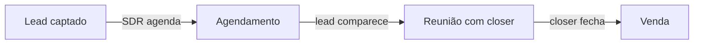
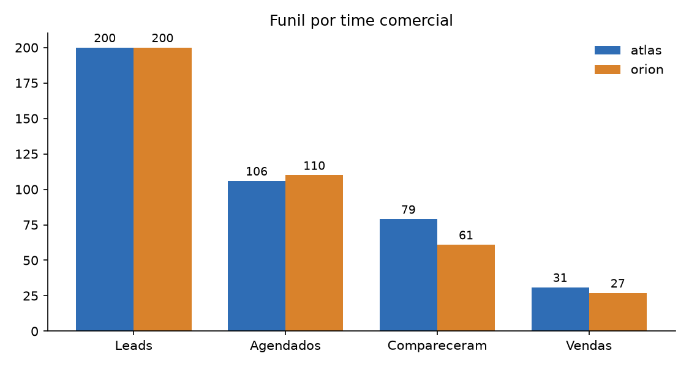
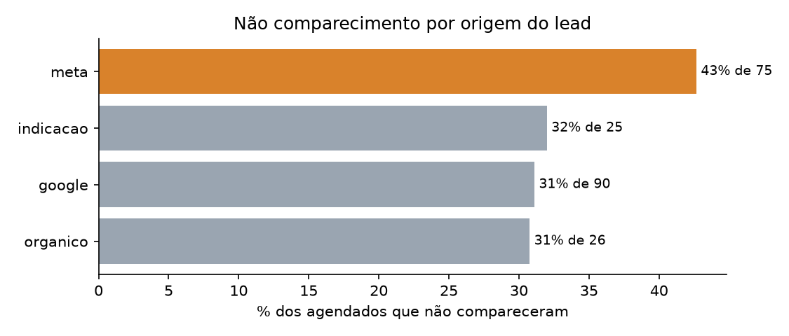
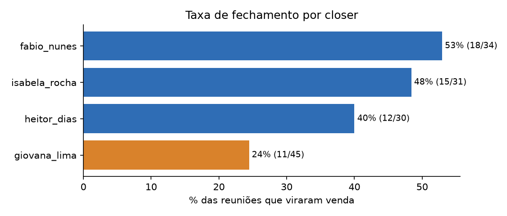

# Funil comercial em DuckDB: do export bagunçado do CRM ao gargalo acionável

Case técnico de análise de dados: pegar três exports de CRM (leads, agendamentos e vendas), tratar sem esconder nenhum problema, medir o funil de dois times comerciais e chegar a recomendações com impacto estimado.

**O que demonstra:** SQL comentado em camadas (raw → staging → métricas), decisão explícita sobre cada defeito de dado, quarentena auditável em vez de `DELETE`, métricas com numerador e denominador declarados, e testes que provam que o tratamento pegou cada problema.

## Contexto

Uma edtech vende um curso por um funil de três etapas, com dois times comerciais (`atlas` e `orion`):



O SDR leva o lead até o agendamento; o closer conduz da reunião até a venda. Os dados chegam como três CSVs exportados do CRM, com todos os defeitos de um export real.

## Como rodar

```bash
python3 -m venv .venv
.venv/bin/pip install duckdb pandas matplotlib pytest
.venv/bin/python rodar.py        # gera os dados, roda o SQL, salva outputs/
.venv/bin/pytest -q              # 19 testes
```

## Estrutura

```
gerador/gerar_dados.py   dataset fictício (semente fixa) com defeitos plantados
dados/                   leads.csv, agendamentos.csv, vendas.csv (o "export do CRM")
sql/00_carga.sql         raw_*: espelho fiel do CSV, sem tratamento
sql/01_tratamento.sql    stg_* + quarentena: dedup, nulos, flags, fontes da verdade
sql/02_metricas_funil.sql  funil geral, por time, por origem e tempos entre etapas
sql/03_gargalos.sql      funil por SDR, por closer, origem x comparecimento, motivos
rodar.py                 orquestra tudo e exporta outputs/*.csv e *.png
tests/test_pipeline.py   confere cada defeito plantado e a consistência das métricas
```

## Tratamento: cada defeito tem uma decisão e um porquê

| Defeito encontrado | Decisão | Por quê |
|---|---|---|
| Linhas 100% idênticas (6 leads, 2 agendamentos, 3 vendas) | `SELECT DISTINCT` | Linha inteira igual é artefato de export, não um segundo evento. Venda duplicada infla receita e conversão. |
| `created_at` nulo em leads | Manter `NULL` + flag | O lead conta no volume; só sai do cálculo de **tempo**, o único que a ausência de data afeta. Não se inventa data. |
| `sdr` nulo em leads | `'nao_informado'` | Um bucket explícito não some do total nem distorce a média dos SDRs reais. |
| `closer` nulo em agendamentos | Manter | **Legítimo:** quem não compareceu nunca chegou ao closer. Testado: `closer IS NULL` ⇔ `NOT compareceu`. |
| Agendamento ou venda com `id_lead` inexistente | Flag `orfao` + quarentena | Apagar mudaria a contagem sem deixar rastro; fora das métricas porque não dá para atribuir a um time. |
| Venda sem agendamento / de lead que não compareceu / de lead "perdido" | Flag + quarentena, mantém na métrica | Quebra a lógica do funil, mas a venda existiu. A correção é na origem (CRM). |
| Lead "convertido" sem venda | Flag + quarentena | CRM fora de sincronia: documentar, não corrigir no grito. |
| Time da venda ≠ time do lead | **Fonte da verdade: leads** | O lead é atribuído ao time na captação. |
| Closer da venda ≠ closer do agendamento | **Fonte da verdade: agendamentos** (primeiro) | Quem conduziu a reunião é quem fechou. O valor original fica guardado para auditoria. |

A tabela `quarentena` é um log de auditoria para o time de CRM, não uma lixeira: nada sai das tabelas `stg_*` por estar lá.

## Diagnóstico

| | Leads | Agendados | Compareceram | Vendas | Agend. | Comparec. | Fechamento | Ponta a ponta |
|---|---:|---:|---:|---:|---:|---:|---:|---:|
| **atlas** | 200 | 106 | 79 | 31 | 53% | **75%** | 39% | 15,5% |
| **orion** | 200 | 110 | 61 | 27 | 55% | **55%** | 44% | 13,5% |
| **geral** | 400 | 216 | 140 | 58 | 54% | 65% | 41% | 14,5% |



Os dois times agendam igual. A diferença inteira está **entre o agendamento e a reunião**: o orion perde 49 agendados contra 27 do atlas, mesmo fechando melhor depois que o lead aparece.

### Gargalo 1: comparecimento do orion, e o motivo é processo

Dos 49 não comparecimentos do orion, **24 são "remarcou"** (contra 8 no atlas). Remarcação em massa é sintoma de agendamento sem confirmação, não de lead ruim: o lead queria a reunião, mas o horário não foi validado.

### Gargalo 2: meta traz volume, mas o lead agenda e some



O lead de meta falta em 43% das reuniões, contra 31% do google. Depois que comparece, ele fecha **46,5%**, o melhor índice entre os canais. O problema não é a qualidade do lead na venda; é a temperatura dele entre o agendamento e a reunião.

### Gargalo 3: um closer com metade da taxa dos colegas



`giovana_lima` recebe o **maior** volume de reuniões (45) e fecha 24%, contra 47% da média dos outros três. É o pior lugar para o lead mais caro do funil (o que já compareceu) parar.

## Recomendações (impacto estimado sobre os dados do case)

1. **Confirmação ativa no orion** (mensagem no D-1 e 2 h antes, com reagendamento de um clique). Se o orion igualar o comparecimento do atlas (75%), são **+21 reuniões** × 44% de fechamento ≈ **+9 vendas ≈ R$ 56 mil** no período, sem um lead a mais.
2. **Redistribuir reuniões e acompanhar o closer de menor fechamento.** No nível dos colegas (47%), as 45 reuniões dela virariam **+10 vendas ≈ R$ 67 mil**. Primeiro passo: escuta de calls para separar problema de abordagem de problema de mix de lead.
3. **Régua de aquecimento para leads de meta** entre o agendamento e a reunião (conteúdo + lembrete). Ataca o canal com maior no-show e melhor fechamento: cada ponto de comparecimento recuperado ali vale mais que em qualquer outro canal.

> Ressalva: as origens indicação e orgânico têm amostras pequenas (35 e 50 leads). Não recomendo decisão de verba por elas sem mais período.

## Perguntas que a banca fez, e as respostas

- **Por que remover duplicados sem investigar a causa?** Linha 100% idêntica, inclusive o ID, não é um segundo evento; é o mesmo registro exportado duas vezes. Se os IDs fossem diferentes com o resto igual, aí seria investigação.
- **Por que manter o órfão em quarentena em vez de excluir?** Excluir esconde o problema do time de CRM e muda a contagem sem deixar rastro.
- **Por que o time vem de leads e o closer de agendamentos?** Cada atributo vem da tabela onde ele é decidido: o time na captação, o closer na reunião.
- **Como validar contra o CRM real?** Reconciliar contagens por dia e por time com o relatório nativo do CRM antes de publicar qualquer taxa; divergência acima de 1% volta para a quarentena.

---

<sub>Dados 100% fictícios, gerados por `gerador/gerar_dados.py`. Projeto inspirado num case técnico real de processo seletivo, refeito com dataset novo; times, pessoas e valores são inventados.</sub>
